# Temperature Tile Card

[](https://github.com/Antaresf1024/temperature-tile-card/actions/workflows/validate.yml)

Carte Lovelace autonome pour Home Assistant : une tuile « valeur + libellé »
dont le fond prend la couleur de la température. L’échelle est soit
**absolue** (seuils réglables), soit **relative à la maison** : la pièce la
plus fraîche est bleue, la plus chaude est corail, les autres se placent
entre les deux. Un indicateur de chauffe animé signale les pièces dont le
chauffage est en marche.



<sub>Aperçu généré par le moteur de la carte (`npm run preview`), échelle absolue par défaut.</sub>

## Fonctionnalités

- échelle absolue (seuils froid / neutre / chaud) ou relative « maison »
  (min → max des capteurs ou zones de référence) ;
- valeur issue d’un capteur, d’un `climate` ou d’une entité `weather`, ou, à
  défaut, **moyenne des références** (tuile « Maison ») ;
- indicateur de chauffe : icône pulsée dont la vitesse, l’amplitude et la
  lueur suivent l’intensité (ouverture de vanne, puissance…) ;
- signalement des données anciennes (tuile grisée et pastille horloge) ;
- texte toujours lisible : couleur choisie selon la luminance du fond, police
  réduite plutôt que tronquée quand le libellé est long ;
- éditeur visuel natif, compatible avec la vue **sections** ;
- actions `tap`, `hold` et `double_tap` standard ;
- accessible : `aria-label` complet, navigation clavier, respect de
  `prefers-reduced-motion` ;
- aucune dépendance : un seul fichier JavaScript.

## Installation

Home Assistant 2024.11 ou plus récent.

### Avec HACS

1. Ouvrez HACS.
2. Ajoutez ce dépôt comme **dépôt personnalisé** de type **Tableau de bord**
   (*Dashboard*) :
   `https://github.com/Antaresf1024/temperature-tile-card`
3. Installez **Temperature Tile Card**.
4. Rechargez la page du navigateur.

### Manuellement

1. Copiez `temperature-tile-card.js` dans le dossier `www` de votre
   configuration Home Assistant (`/config/www/`).
2. Dans **Paramètres → Tableaux de bord → ⋮ → Ressources**, ajoutez la
   ressource `/local/temperature-tile-card.js?v=1.0.0` de type
   **Module JavaScript**.
3. Rechargez la page du navigateur.

À chaque mise à jour manuelle, changez le suffixe `?v=` pour que les
navigateurs abandonnent l’ancienne version en cache.

## Exemples

Pièce équipée d’un thermostat : la température et l’indicateur de chauffe
proviennent du même `climate`.

```yaml
type: custom:temperature-tile-card
name: SALON
temperature_entity: climate.salon
```

Tuile « Maison » : moyenne des pièces, colorée par rapport à la pièce la plus
fraîche et à la plus chaude.

```yaml
type: custom:temperature-tile-card
name: MAISON
temperature_color:
  mode: relative
  reference_areas:
    - salon
    - cuisine
    - chambre
    - bureau
```

Capteur dédié, intensité de chauffe donnée par l’ouverture d’une vanne
(0 à 100 %), seuils resserrés et alerte au-delà de 30 minutes sans relevé.

```yaml
type: custom:temperature-tile-card
name: BUREAU
temperature_entity: sensor.bureau_temperature
heating_entity: sensor.bureau_vanne_ouverture
stale_after: 30
temperature_color:
  mode: absolute
  min: 16
  mid: 20
  max: 24
```

Les identifiants d’entités et de zones ci-dessus sont des exemples à remplacer
par les vôtres.

## Options

| Option | Type | Défaut | Rôle |
|---|---|---|---|
| `type` | texte | — | `custom:temperature-tile-card` |
| `name` | texte | `Maison` | Libellé affiché sous la valeur. |
| `temperature_entity` | entité `sensor`, `climate` ou `weather` | — | Température affichée. Vide : moyenne des références. |
| `climate_entity` | entité `climate` | la source, si c’est un `climate` | Thermostat dont `hvac_action: heating` allume l’indicateur. |
| `heating_entity` | entité `binary_sensor`, `climate` ou `sensor` | — | Remplace `climate_entity` pour l’indicateur (voir plus bas). |
| `heating_icon` | icône | `mdi:radiator` | Icône de l’indicateur de chauffe. |
| `height` | nombre (px) | `74` | Hauteur de la tuile, 48 px au minimum. |
| `precision` | nombre (0 à 3) | `1` | Décimales de la température. |
| `temperature_color.mode` | `absolute` ou `relative` | `absolute` | Type d’échelle. |
| `temperature_color.min` / `mid` / `max` | nombre (°C) | `-5` / `15` / `35` | Seuils de l’échelle absolue. |
| `temperature_color.cool` / `neutral` / `warm` | `[r, g, b]`, `#rrggbb` ou `r,g,b` | bleu / ivoire / corail | Couleurs des deux échelles. |
| `temperature_color.reference_entities` | liste d’entités | `[]` | Références de l’échelle relative et de la moyenne. |
| `temperature_color.reference_areas` | liste de zones (`area_id`) | `[]` | Zones dont les capteurs servent de références. |
| `tap_action` | action | `more-info` | Action au clic. |
| `hold_action` | action | aucune | Action sur appui long (environ 0,5 s). |
| `double_tap_action` | action | aucune | Action sur double-clic. |
| `tap_entity` | entité | la source | Entité ouverte par `more-info` ou basculée par `toggle`. |
| `stale_after` | nombre (min) | désactivé | Ancienneté au-delà de laquelle la tuile est marquée périmée. |
| `stale_entity` | entité | la source | Entité dont la fraîcheur est surveillée. |

Les actions acceptent `more-info`, `navigate` (`navigation_path`), `url`
(`url_path`, `new_tab`), `toggle`, `perform-action` (`perform_action`, `data`,
`target`) et `none`.

L’éditeur visuel n’affiche que les champs utiles au mode choisi : seuils et
couleurs en mode absolu, références en mode relatif. En YAML, les couleurs
s’appliquent aussi en mode relatif, et des références peuvent servir de
moyenne en mode absolu.

## Échelle relative « maison »

Les références sont les entités de `reference_entities`, puis, pour chaque
zone de `reference_areas`, les capteurs de température de la zone. Un capteur
de zone n’est retenu que s’il :

- a la classe `temperature` et l’unité `°C` ;
- n’est ni masqué, ni de catégorie diagnostic ou configuration ;
- a été mis à jour il y a moins de 2 heures ;
- donne une valeur comprise entre -40 et 60 °C ;
- n’est pas un capteur technique reconnu par son identifiant (température
  interne d’appareil, processeur, carte graphique, batterie, réfrigérateur,
  congélateur, plateau d’imprimante 3D, consigne, dérivée, variateur Shelly,
  tête thermostatique Tado…).

Les capteurs sont moyennés par appareil, puis par zone : une zone pèse autant
qu’une autre, quel que soit son nombre de capteurs.

Lorsque l’écart entre la référence la plus froide et la plus chaude est
inférieur à 0,15 °C, la tuile prend un gris neutre uniforme. Si aucune
référence n’est disponible, la carte se rabat sur les seuils absolus. Les
références sont recalculées au plus une fois toutes les 30 secondes.

## Indicateur de chauffe

La source de l’indicateur est `heating_entity` si elle est renseignée, sinon
`climate_entity`, qui reprend automatiquement `temperature_entity` lorsque
celle-ci est un `climate`.

| Source | Chauffe active | Intensité |
|---|---|---|
| `climate` | `hvac_action` vaut `heating` | 100 % |
| `binary_sensor` | état `on` | 100 % |
| valeur numérique | supérieure à 0 | la valeur, bornée entre 0 et 100 % |

Plus l’intensité est forte, plus l’icône pulse vite, grossit et rougeoie. Le
survol affiche une infobulle (« Chauffe · 40 % »). Une source absente,
inconnue ou indisponible n’affiche aucune icône.

## Vue sections et moteur exposé

Dans une vue **sections**, la tuile occupe 6 colonnes par défaut (2 au
minimum) et garde la hauteur fixée par `height`.

Le moteur d’échelle est exposé, pour réutilisation facultative, sous
`window.TemperatureTileCardEngine` (`temperatureTile`, `temperatureFill`,
`relativeTemperatureFill`, `referenceTemperatures`, `entityTemperature`) et
sous forme d’exports ES.

## Limites

- L’interface (éditeur, infobulles, libellés d’accessibilité) est en français
  uniquement.
- Le filtre des capteurs techniques repose sur leurs identifiants : un capteur
  au nom inhabituel peut passer au travers. Préférez alors
  `reference_entities`.
- L’infobulle de chauffe s’affiche au survol de la souris, pas au toucher.

## Développement

Node.js 20 ou plus récent, sans aucune dépendance à installer :

- `npm test` lance les tests hors Home Assistant ;
- `npm run check` vérifie la syntaxe de la carte ;
- `npm run preview` régénère `docs/apercu.svg`.

La version est portée par la constante `CARD_VERSION` de la carte et publiée
sous forme de release GitHub `vX.Y.Z`.

## Signaler un problème

Ouvrez un [ticket GitHub](https://github.com/Antaresf1024/temperature-tile-card/issues)
en joignant la configuration YAML de la carte et la version affichée dans la
console du navigateur.

## Licence

[MIT](LICENSE) © 2026 Antaresf1024

---

## English summary

**Temperature Tile Card** is a standalone Home Assistant Lovelace card: a
“value + label” tile whose background is tinted by temperature, either on an
**absolute** scale (configurable cold / neutral / warm thresholds) or on a
**relative “house”** scale spanning the coolest to the warmest reference
sensor or area. Without a dedicated sensor, the tile shows the average of its
references. An animated heating indicator follows a `climate` entity’s
`hvac_action`, a binary sensor, or a 0–100 % value such as a valve opening.

It ships a native visual editor, supports sections views, standard
tap / hold / double-tap actions, stale-data marking and reduced motion, and
has no dependencies. Install it through HACS as a custom **Dashboard**
repository, or copy `temperature-tile-card.js` to `/config/www/` and add it
as a JavaScript module resource. The user interface is currently in French
only.
